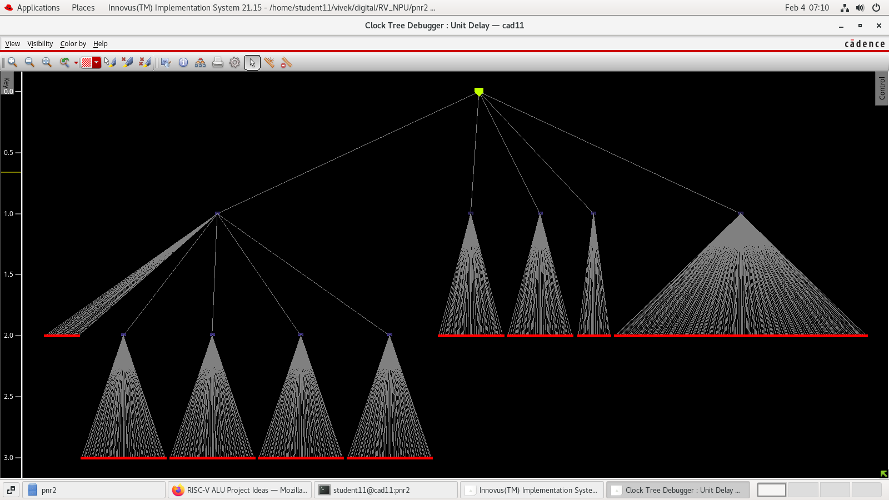
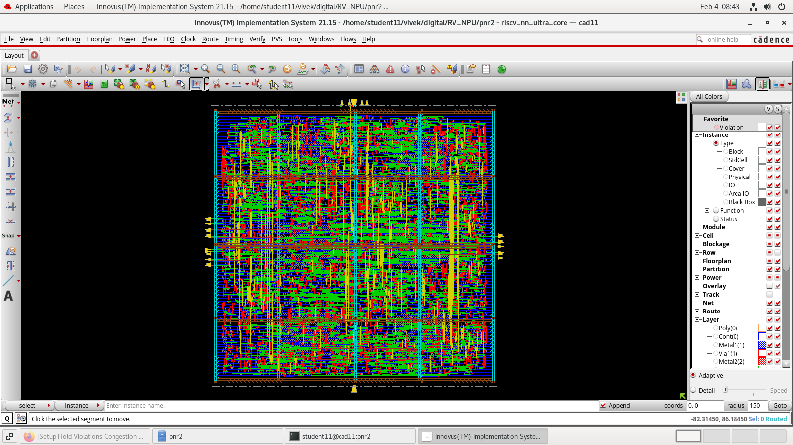

# Physical Design — Cadence Innovus

This directory documents the physical-design implementation of the RV-NPU ASIC using Cadence Innovus.

The design proceeds from the synthesized gate-level netlist through floorplanning, power planning, standard-cell placement, clock-tree synthesis (CTS), routing, and post-route analysis.

## Tool and Technology

- **Physical Design Tool:** Cadence Innovus
- **Technology:** 90 nm standard-cell library
- **Target Clock Period:** 10 ns
- **Target Frequency:** 100 MHz

## Physical Design Flow

```text
Synthesized Netlist
        │
        ▼
   Design Import
        │
        ▼
   Floorplanning
        │
        ▼
  Power Planning
        │
        ▼
 Standard-Cell Placement
        │
        ▼
 Clock-Tree Synthesis
        │
        ▼
      Routing
        │
        ▼
 Post-Route Analysis
        │
        ▼
     GDSII Export
```

## Clock-Tree Synthesis (CTS)

Clock-tree synthesis creates the clock-distribution network connecting the clock source to sequential elements. The objective is to manage clock latency and skew while satisfying timing requirements.

The following image shows the CTS stage of the RV-NPU implementation in Cadence Innovus.



## Final Routed Layout

The final routed layout shows the physical implementation after placement, clock-tree synthesis, routing, and applicable optimization.



## Implementation Results

The following results were obtained from Cadence Innovus post-route analysis.

| Metric | Result |
|---|---:|
| Technology | 90 nm |
| Supply Voltage | 1.1 V |
| Target Frequency | 100 MHz |
| Clock Period | 10 ns |
| Total Instance Count | 7,431 |
| Cell Area | 91,730.225 µm² |
| Total Power | 8.696 mW |
| Internal Power | 6.226 mW |
| Switching Power | 1.608 mW |
| Leakage Power | 0.861 mW |
| Setup WNS	| +0.107 ns |
| Hold WNS	| 0.000 ns |
| Setup TNS	| 0.000 ns |


## GUI Workflow Guide

The [`GUI_Guide`](./GUI_Guide/) directory contains project-based notes explaining the physical-design workflow using the Cadence Innovus GUI.

The guide covers design import, timing setup, floorplanning, power planning, placement, CTS, routing, timing analysis, and GDSII export.

## Related Stages

- [Synthesis](../Synthesis/README.md) — RTL synthesis and synthesis-stage results
- [Simulation](../Simulation/README.md) — RTL simulation and functional verification
- [Architecture](../Architecture/README.md) — RV-NPU architecture diagrams
